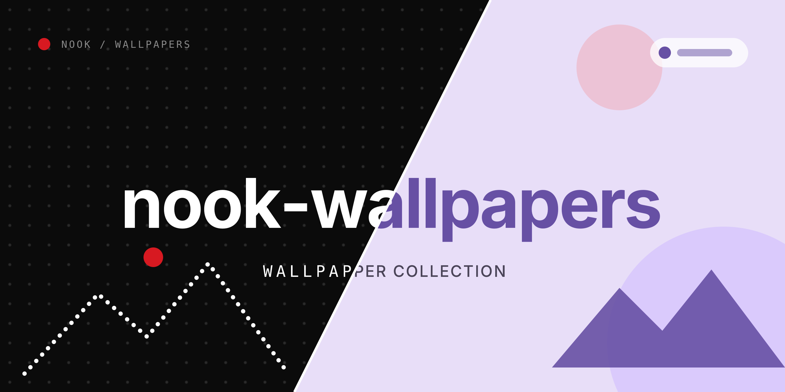

<div align="center">



# Rice Wallpapers

**Nook's curated wallpaper collection for the Edots rice.**


</div>

## About

Wallpapers picked to work with both Edots designs — **Material 3 Expressive**
and **Nothing**. Every image generates its own palette, so light and dark
variants stay readable.

The folder is cloned by `install.sh` into `~/Pictures/Wallpapers`:

```
git clone https://github.com/Edgit13/Rice-Wallpapers.git ~/Pictures/Wallpapers
```

Edots reads this folder from the wallpaper picker and sorts it into color
categories. Files are never modified or moved.

## Usage

1. Open the wallpaper picker from the bar (or `edots wallpaper`).
2. Pick a wallpaper — the whole desktop recolors from it.
3. To re-apply the palette manually: `edots theme sync`.

## License

Wallpapers belong to their original authors. The collection is shared for
personal use; remove any image on request.
